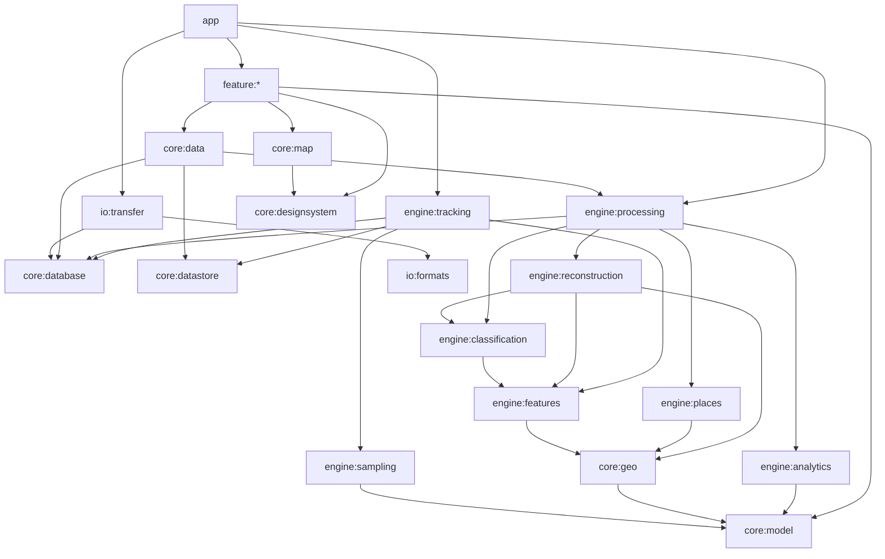
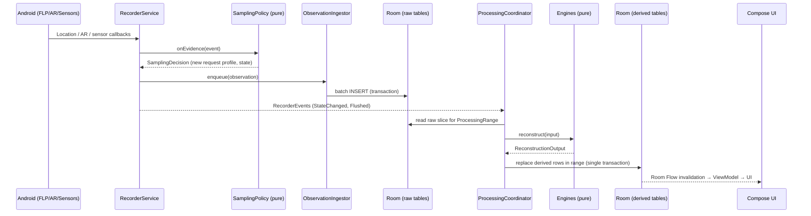

# Architecture

Authoritative for: technology stack, module graph and dependency rules, runtime components and processes, threading, data flow, and background work policy.
Interfaces and types: [ENGINEERING_CONTRACTS.md](ENGINEERING_CONTRACTS.md). Schema: [DATA_MODEL.md](DATA_MODEL.md).

---

## 1. Architectural principles

1. **Raw is sacred, derived is disposable.** Observations are append-only. Everything shown to the user is a deterministic function of raw data, user corrections and versioned parameters, and can be rebuilt.
2. **Pure core, thin platform shell.** All algorithms (filtering, features, classification, reconstruction, analytics, places, export formats) live in **JVM-only Kotlin modules** with no Android dependency. They are testable on a laptop with fixtures. Android modules adapt OS APIs to those cores.
3. **Single writer for the derived layer.** One `ProcessingCoordinator` serialises every derived-layer mutation. This prevents races between live processing, corrections and backfills.
4. **Local-first, no server.** Nothing in the core flow touches the network. Map tiles are the only routine network use.
5. **Honest state.** UI state is derived from evidence (liveness, last fix, permissions), never from intent flags.
6. **Boring technology where possible.** Each dependency must justify itself (§3).

## 2. Platform choice [R] (ADR-001)

**Native Android, Kotlin, Jetpack Compose.** Alternatives were evaluated:

| Option | Verdict | Reason |
|---|---|---|
| Native Kotlin + Compose | **Chosen** | Direct access to FGS, FLP, AR, Geofencing, sensors, GnssStatus, `PowerManager`, OEM intents. Best control of the background lifecycle, which is the hardest requirement. Compose supports a fully custom design system. |
| Flutter | Rejected | Background tracking would still require native Kotlin services and platform channels. The UI layer adds a second language and runtime without benefit for a single-platform app, and map plugin maturity varies. |
| React Native | Rejected | Same native-service problem, plus a JS runtime in a long-lived process and bridge overhead on high-frequency data. |
| Kotlin Multiplatform (shared core) | Deferred | The pure-JVM core modules are written so they *could* become KMP `commonMain` later (no `java.*` in domain APIs except `java.time`, isolated). There is no iOS requirement today, so KMP tooling cost is not justified. |

## 3. Technology stack [R]

Versions: WI-001 pins the **latest stable** of each in `gradle/libs.versions.toml` and records them in `STATUS.md`. Minimum acceptable versions are given where a feature depends on them.

| Concern | Choice | Notes |
|---|---|---|
| Language | Kotlin ≥ 2.1, JVM toolchain 17 | K2 compiler; `explicitApi()` in core/engine modules |
| Build | Gradle (Kotlin DSL) + version catalog + `build-logic` convention plugins | AGP ≥ 8.7 |
| UI | Jetpack Compose (BOM), `foundation` + `material3` (only as an internal base; every visible component is wrapped by `:core:designsystem`) | Compose compiler via Kotlin plugin |
| Navigation | Navigation Compose with type-safe routes (`@Serializable` route objects) | ≥ 2.8 |
| DI | Hilt (+ `hilt-work`, `hilt-navigation-compose`) | Works with Services, Workers and ViewModels. JVM modules use constructor injection only (no Hilt annotations other than `@Inject` from `javax.inject`) |
| Async | Kotlin Coroutines + Flow | `kotlinx-coroutines-test` for tests |
| Database | Room (KSP), SQLite WAL mode | ≥ 2.6. Bundled SQLite **not** used (platform SQLite is fine at API 31+) |
| Settings | DataStore with a kotlinx-serialization JSON `Serializer<AtlasSettings>` | Typed `AtlasSettings`; no Proto schema is used |
| Location | `play-services-location` (FLP, ActivityRecognition, Geofencing) + platform `LocationManager` fallback | |
| Maps | **MapLibre Native Android** | Vector tiles; 16 KB-aligned binaries (verify in WI-001) |
| Map tiles | **OpenFreeMap** public vector tiles (OpenMapTiles schema), configurable URL | No key, OSM data, ODbL attribution (ADR-008) |
| Charts | Custom Compose `Canvas` charts in `:core:designsystem` | ADR-010 |
| Serialization | kotlinx-serialization-json | Fixtures, backup manifest, settings |
| Background work | WorkManager | Only for deferrable, resumable jobs (§6) |
| Crypto | JCA `AES/GCM/NoPadding`, PBKDF2WithHmacSHA256 (600 000 iterations) for backups; Android Keystore for the app-lock gate | No third-party crypto library |
| Biometrics | `androidx.biometric` | App lock (P1) |
| Splash | `androidx.core:core-splashscreen` | |
| Fonts | IBM Plex Sans + IBM Plex Mono (OFL), bundled | No downloadable fonts (would be a network call) |
| Testing | JUnit 4, Google Truth, Turbine, MockK (sparingly; prefer fakes), Robolectric (Room/DataStore JVM tests), Compose UI test, **Roborazzi** (JVM screenshot tests), AndroidX Test + Gradle Managed Devices, Macrobenchmark + Baseline Profiles | |
| Static analysis | Android Lint (warnings as errors for listed checks), detekt, ktlint (via Spotless) | |
| CLI tool | `:tools:replay`, a pure JVM application | Runs the pipeline on fixtures, prints metrics |

**Explicitly not used:** Firebase (any), Crashlytics, analytics SDKs, Google Maps SDK (ADR-008), Retrofit/OkHttp at the app layer (MapLibre has its own HTTP stack and no other HTTP is needed), RxJava, SQLCipher (ADR-012), TensorFlow Lite in v1 (ADR-006).

## 4. Module graph

### 4.1 Modules

Type: **J** = pure Kotlin/JVM library (`kotlin("jvm")`); **A** = Android library; **App** = application.

| Module | Type | Responsibility |
|---|---|---|
| `:app` | App | `Application`, `MainActivity`, NavHost, Hilt root, manifest (permissions, services, receivers), app-wide wiring |
| `:core:model` | J | Shared domain types, ids, enums with stable codes (ENGINEERING_CONTRACTS §2) |
| `:core:common` | J | `Clock`, `AtlasResult`/errors, `DispatcherProvider` interface, logging facade `AtlasLog`, units/formatting primitives |
| `:core:geo` | J | Geodesy (haversine, Vincenty not needed), ENU projection, bearings, Douglas–Peucker, encoded polyline (precision 6), geohash, bbox, Kalman/RTS smoother |
| `:core:database` | A | Room database, entities, DAOs, migrations, type converters, journal-spill file |
| `:core:datastore` | A | `AtlasSettings` proto/JSON DataStore |
| `:core:data` | A | Repository implementations of domain interfaces; mapping entity ↔ model |
| `:core:designsystem` | A | Tokens, theme, typography, all shared Compose components, charts, icons |
| `:core:map` | A | MapLibre wrapper composable `AtlasMap`, styles (assets), route/stop/gap layers, camera utils, offline region manager |
| `:core:testing` | J | Fixture format reader/writer, synthetic track generator, fakes for engine interfaces, test clocks |
| `:core:testing-android` | A | Hilt test runner, in-memory DB rules, fake platform sources |
| `:engine:tracking` | A | `RecorderService`, platform sources (location, AR, sensors, GNSS, power, permissions), sampling state machine host, ingestion buffer and writer, liveness, health monitor, boot/update/AR/geofence receivers, watchdog worker |
| `:engine:sampling` | J | **Pure** sampling state machine (`SamplingPolicy`), so it is testable on the JVM |
| `:engine:features` | J | Epoching; GPS, IMU and AR feature extraction; motion-window feature computation (pure function over sample arrays) |
| `:engine:classification` | J | Baseline likelihood model, parameter loading, HMM forward–backward + constrained Viterbi, calibration |
| `:engine:reconstruction` | J | Quality filter, smoothing, stay detection, segmentation, journey assembly, correction application, per-segment metrics |
| `:engine:places` | J | Place candidate clustering, visit assignment, route fingerprinting and clustering |
| `:engine:analytics` | J | Daily aggregate computation, period rollups, records, trends, distributions |
| `:engine:processing` | A | `ProcessingCoordinator` (single writer), live processor, range expansion, persistence of derived results in transactions, reprocess/backfill workers |
| `:io:formats` | J | GPX/CSV/GeoJSON writers and GPX parser, backup archive format (manifest, encryption), streaming |
| `:io:transfer` | A | Export/import/backup/restore workers, SAF integration, export job tracking |
| `:feature:onboarding` | A | S01–S03 |
| `:feature:day` | A | S04 Day screen (Today) |
| `:feature:history` | A | S06 History (calendar + list + filters) |
| `:feature:journey` | A | S07 detail, S08 playback, S09 edit, S10 mode picker |
| `:feature:insights` | A | S11–S14 analytics, heatmap, routes |
| `:feature:places` | A | S15–S16 |
| `:feature:settings` | A | S17–S22, S25 |
| `:feature:diagnostics` | A | S23–S24 |
| `:tools:replay` | J (application) | CLI: `replay <fixture> [--params x] [--report json]` |
| `:benchmark` | A (test) | Macrobenchmarks, baseline profile generator |

### 4.2 Dependency rules (enforced)

Rules:
1. `feature:*` modules **never** depend on each other, on `core:database`, or on any `engine:*` module. They talk only to `core:data` repositories and to `engine:tracking`'s public `TrackingController` facade, which is exposed through a `core:data` interface (ENGINEERING_CONTRACTS §4).
2. JVM modules (`J`) never depend on Android modules.
3. `engine:tracking` does not depend on `engine:processing`. It notifies processing through the `RecorderEvents` flow defined in `core:model`, which `app` wires (§5.3). This keeps the recorder minimal and crash-isolated.
4. No cycles. Enforced by Gradle (cycles fail the build) plus the `dependency-guard` style check in `build-logic` that compares against `docs/`-specified allowed edges (WI-002).
5. Only `:app` may declare `<uses-permission>`, services and receivers in its manifest. Library manifests are empty except for `engine:tracking`, which declares its service and receivers (merged).

## 5. Runtime architecture

### 5.1 Processes

A **single process** (ADR-004). The recorder runs in the main process. Rationale: OEM killers act per package (a separate `:recorder` process gives little protection on OxygenOS), Room multi-process invalidation adds complexity, and one process means one `ProcessingCoordinator` instance.

### 5.2 Long-lived components

| Component | Lifecycle owner | Scope |
|---|---|---|
| `RecorderService` (FGS, type `location`) | Android, started by `TrackingController` | While tracking is enabled and permitted |
| `SamplingController` | `RecorderService` | Service lifetime; hosts the pure `SamplingPolicy` |
| `ObservationIngestor` | `RecorderService` | Buffered writer; flush every 10 s or 20 observations, whichever comes first, and on every state change and `onDestroy` |
| `LivenessHeartbeat` | `RecorderService` | 60 s tick; extends the current `liveness_span` |
| `HealthMonitor` | Application (singleton) | Observes permissions, providers, power-save, battery-opt status; emits `TrackingHealth` |
| `ProcessingCoordinator` | Application (singleton, `@Singleton`) | Process lifetime; owns a single-consumer `Channel<ProcessingCommand>` |
| `LiveProcessor` | `ProcessingCoordinator` | Recomputes the open journey every 60 s while UI visible, every 5 min otherwise, and on every recorder state change |

### 5.3 Data flow

### 5.4 Threading [R]

| Work | Dispatcher | Rule |
|---|---|---|
| OS callbacks (location, AR, sensor) | Dedicated `HandlerThread("atlas-sensors")` looper for sensor and location callbacks | Callbacks do O(1) work: convert and `trySend` into a channel. **No I/O on callback threads.** |
| Sampling policy | Single-threaded `recorderDispatcher` = `Dispatchers.Default.limitedParallelism(1)` | All recorder state mutations happen here; no locks needed |
| DB writes (ingest) | `Dispatchers.IO` via Room suspend DAOs | Batched |
| Processing | `processingDispatcher` = `Dispatchers.Default.limitedParallelism(1)` | Single consumer of the coordinator channel → serialised derived writes |
| UI | Main | ViewModels expose `StateFlow` (`stateIn(WhileSubscribed(5_000))`) |

Never use `GlobalScope`, `runBlocking` (except in tests and `main()` of `:tools:replay`) or `Thread.sleep`.

### 5.5 Recorder ↔ processing coupling

`engine:tracking` exposes `RecorderEvents: SharedFlow<RecorderEvent>` (in `core:model` types). In `app`, `ProcessingBootstrap` (an `Application`-scoped initialiser) collects it and sends `ProcessingCommand`s:

| RecorderEvent | ProcessingCommand |
|---|---|
| `StateChanged(MOVING → STOP_PENDING / STATIONARY)` | `ReprocessTail` (closes candidate journeys) |
| `Flushed` while `MOVING` (throttled as per §5.2) | `RefreshOpenJourney` |
| `SessionRecovered(gapStart, gapEnd)` | `ReprocessRange(gap ± anchors)` |

User corrections from `core:data` send `ApplyCorrection(range)`; version upgrades enqueue `FullReprocess` via WorkManager.

## 6. Background work policy [R]

| Job | Mechanism | Constraints | Checkpointing |
|---|---|---|---|
| Live / tail processing | Coroutine in `ProcessingCoordinator` | none | n/a (small ranges) |
| Correction reprocessing | Coroutine in `ProcessingCoordinator` | none; user is waiting | n/a |
| Full reprocess after version change | `FullReprocessWorker` (unique, KEEP) | battery not low | Cursor stored in `processing_run.cursor_utc_ms`. Processes ≤ 7 days per transaction. Resumes from the cursor after a stop |
| Place & route clustering | `ClusteringWorker` daily + after every 10 confirmed journeys | battery not low | Idempotent |
| Export / backup / import | `TransferWorker` as an **expedited** job with a foreground notification (type `dataSync` is allowed: user-initiated, not from boot) | none | `export_job.progress` + temp file. Restart = start over, temp file deleted |
| Compaction (retention) | `CompactionWorker` weekly | charging + idle | Per-month transaction |
| Watchdog | `WatchdogWorker` periodic 15 min | none | Stateless: if tracking is enabled and no liveness for > 5 min, start only when the current Android start path has both background-location access and a valid exemption; otherwise post the "Recording stopped" notification with a tap-to-resume action |

## 7. Error-handling architecture

- Domain errors are values: `AtlasResult<T>` with a sealed `AtlasError` hierarchy (ENGINEERING_CONTRACTS §3). Exceptions are for programmer errors.
- Every platform failure that affects recording becomes a `HealthEvent` with a stable `HealthEventType` code. Health events drive both the UI and gap attribution.
- Uncaught exceptions: a custom `Thread.UncaughtExceptionHandler` writes a redacted crash record (stack trace, no coordinates) to `files/crash/` and then delegates to the default handler. It is shown in Diagnostics and is never uploaded.

## 8. Configuration & build variants

| Variant | Purpose |
|---|---|
| `debug` | Development; StrictMode on; "Developer" section in Diagnostics (fixture injection, fake location provider toggle, force state) |
| `release` | R8 full mode, signed with the owner's key (never committed), StrictMode off |
| `benchmark` | Release-like, debuggable=false, for Macrobenchmark |

There are no product flavours. Feature flags live in `AtlasSettings.experimental` (e.g. `railProximityEvidence`), are default-off, and are visible in Diagnostics → Developer in debug builds only.
